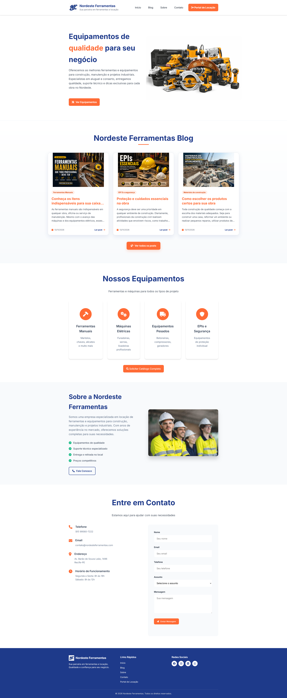
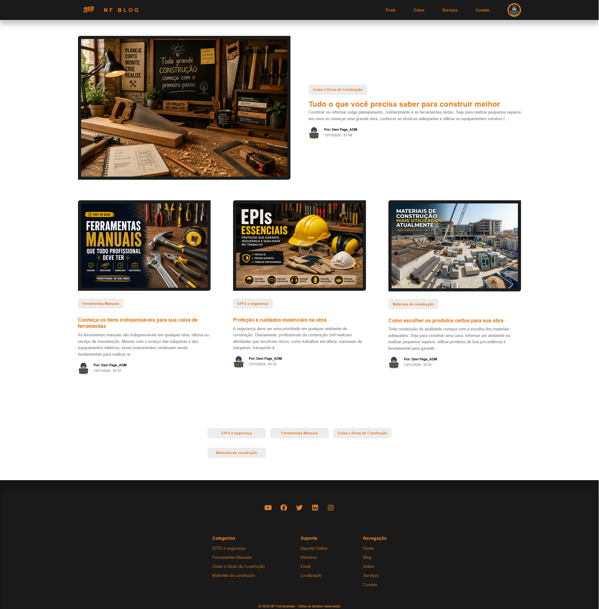

# Nordeste Ferramentas

O primeiro projeto de um desenvolvedor júnior, feito para um amigo.

A Nordeste Ferramentas é uma empresa de aluguel e compra de ferramentas de construção. O pedido foi um site institucional e um blog. O sistema de aluguel também faz parte da ideia, mas fica para um plano futuro. Tudo foi feito para a web e funciona de forma responsiva.

## Telas

Prints de tela cheia do site institucional e do blog. Coloque as imagens nestes caminhos antes de publicar:

## Stack

- **Site institucional:** HTML, CSS e JavaScript, sem framework. A página usa a fonte Inter e ícones do Font Awesome.
- **Blog:** PHP 8 e MariaDB/MySQL, com consultas via `mysqli`. Em desenvolvimento, roda no Apache do XAMPP.
- **Ligação entre os dois:** a vitrine do site consome a API pública `nf_blog/api/latest-posts.php`, que responde em JSON.
- **Configuração:** URL e banco vêm das variáveis `NF_*`. Os valores locais de desenvolvimento ficam como fallback. O modelo está em `.env.example`.

## Arquitetura

O repositório tem duas partes públicas, e as duas conversam pelo mesmo banco do blog.

A raiz (`index.html`) só redireciona para o site institucional, em `site_principal/`. Essa parte é uma página estática: apresentação da empresa, contato e uma vitrine com os três posts mais recentes. O `script.js` chama a API, confere a resposta e monta os cards com texto puro, sem interpretar HTML vindo de fora. O botão do Portal de Locação abre um aviso: o sistema de aluguel ainda não tem endereço próprio.

O blog fica em `nf_blog/` e é renderizado no servidor.

- As páginas públicas cobrem a home, a listagem, o post, a categoria, a busca, sobre, serviços, contato, cadastro e login.
- A área administrativa faz o cadastro, a edição e a exclusão de posts, categorias e usuários.
- `config/` concentra o que as páginas compartilham: endereço e credenciais, conexão com o MySQL, sessão, papéis de acesso (`admin` e `author`) e proteção CSRF dos formulários que alteram dados.
- A senha é guardada só como hash. A sessão não leva a senha.
- A API lê os três posts mais novos, junto com a categoria, e devolve título, resumo, data, imagem e o link do post. A vitrine do site institucional usa exatamente essa resposta.

O banco `nf_blog` tem as tabelas `users`, `categories` e `posts`. A estrutura para importar está em `nf_blog/database/database.sql`.

As variáveis `NF_ALUGUEL_*`, no `.env.example`, já separam o futuro sistema de aluguel do banco do blog. Esse sistema ainda não está neste repositório.

## Blog, API e testes

O blog é a parte mais complexa do projeto: tem API, banco de dados, login e painel administrativo. Por isso também existe um registro dos testes em `nf_blog/database/testes-nf-blog.pdf`, junto com checklists manuais de autenticação, cadastro, posts, categorias, usuários e preparação para produção.

No fim, deu certo. Isso não significa que não possa melhorar.

## Agradecimento

Obrigado, Rodrigo, por confiar em mim para fazer este projeto. E desculpa pela demora.

## Como rodar

1. Coloque a pasta do projeto no `htdocs` do XAMPP e suba o Apache e o MySQL.
2. Importe `nf_blog/database/database.sql` no phpMyAdmin. Isso cria o banco `nf_blog`.
3. Abra `http://localhost/Nordeste_Ferramentas/`.

No XAMPP padrão, os fallbacks locais já apontam para `root`, sem senha, no banco `nf_blog`. Fora desse ambiente, defina `NF_ROOT_URL`, `NF_DB_HOST`, `NF_DB_USER`, `NF_DB_PASS` e `NF_DB_NAME` no ambiente do servidor. Um arquivo `.env` solto não é lido pelo PHP.
