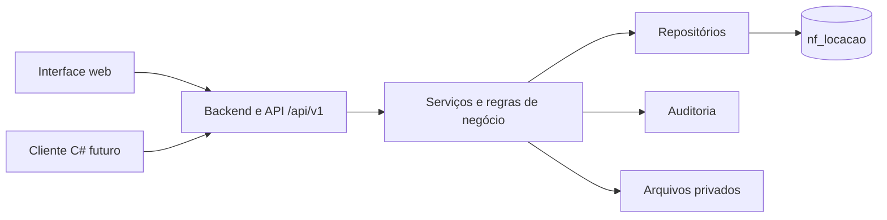

# Sistema de Locação e Vendas — Nordeste Ferramentas

## 1. Apresentação

Este diretório reúne o planejamento oficial do novo Sistema de Locação e Vendas da Nordeste Ferramentas. O sistema será uma aplicação administrativa independente do site institucional e do NF Blog, destinada ao controle de locações, patrimônio, vendas, estoque, clientes, recebimentos e rastreabilidade operacional.

No estado atual, a Fase 1 foi concluída somente no âmbito documental. Não existem aplicação executável, banco operacional, API, interface, autenticação ou integrações implementadas neste diretório.

## 2. Contexto da empresa

A Nordeste Ferramentas está localizada em Recife, Pernambuco, Brasil, e atua com duas operações que precisam permanecer distintas:

- locação de equipamentos físicos identificáveis, cuja disponibilidade depende do período, da reserva, da posse, da inspeção e da manutenção;
- venda de mercadorias, cujo estoque é quantitativo e varia por entradas, saídas, devoluções e ajustes.

O repositório já possui o site institucional e o NF Blog. O novo sistema será instalado ao lado desses componentes, sem transformar o blog em sistema administrativo e sem compartilhar tabelas, contas ou sessões por conveniência.

A primeira versão atenderá uma única unidade operacional. O contexto aprovado usa idioma pt-BR, moeda BRL e fuso America/Recife.

## 3. Objetivos

- controlar o ciclo completo da locação, do orçamento ao encerramento;
- impedir dupla reserva no mesmo período;
- rastrear individualmente as unidades físicas destinadas à locação;
- controlar separadamente produtos e movimentos destinados à venda;
- registrar clientes, contratos, inspeções, manutenções e ocorrências;
- preservar histórico de tarifas, estados, pagamentos e ações críticas;
- aplicar permissões no backend e manter trilha de auditoria;
- disponibilizar uma API versionada para a interface web e uma futura aplicação C#;
- reduzir dependência de planilhas e alterações manuais no banco.

## 4. Tecnologias planejadas

| Área | Tecnologia/diretriz |
|---|---|
| Frontend | HTML5, CSS3 e JavaScript, com interface responsiva e acessível |
| Backend | PHP organizado como monólito modular |
| Persistência | MySQL/MariaDB, InnoDB e utf8mb4 |
| API | HTTP/JSON versionada sob `/api/v1` |
| Valores | Precisão decimal; nunca ponto flutuante binário para dinheiro |
| Segurança | Validação no backend, consultas preparadas, CSRF quando aplicável, menor privilégio e segredos por ambiente |
| Evolução do banco | Migrações incrementais, versionadas e testáveis |
| Cliente futuro | C# consumindo a API, sem acesso direto ao banco |
| Contexto regional | pt-BR, BRL e America/Recife; instantes persistidos em UTC |

Nenhum framework ou dependência adicional foi escolhido nesta fase.

## 5. Arquitetura

A arquitetura aprovada é um monólito modular em PHP. A implantação inicial será única, mas as responsabilidades permanecerão separadas entre:

1. entrada HTTP, rotas e middlewares;
2. controladores;
3. serviços de aplicação e regras de negócio;
4. repositórios e persistência;
5. views HTML e JavaScript;
6. auditoria, logs e armazenamento privado.



O frontend e o cliente C# não acessarão o MySQL/MariaDB diretamente e não duplicarão disponibilidade, preço, estados ou permissões.

## 6. Módulos planejados

1. Identidade e acesso.
2. Clientes.
3. Catálogo e patrimônio de locação.
4. Agenda e disponibilidade.
5. Tarifas, orçamentos, reservas e contratos.
6. Retirada, devolução e inspeção.
7. Manutenção e ocorrências.
8. Catálogo e estoque de venda.
9. Vendas.
10. Financeiro básico.
11. Dashboard e relatórios.
12. Auditoria e configurações.
13. API e integrações.

## 7. Como a operação funcionará

### 7.1. Fluxo de locação


- o rascunho não bloqueia disponibilidade;
- a confirmação reserva capacidade por produto e período;
- a unidade patrimonial pode ser pré-atribuída, mas é obrigatória antes da saída;
- o intervalo operacional é `[início, fim)` com data e hora;
- prorrogações revalidam reservas futuras;
- devoluções parciais preservam os itens ainda em posse do cliente;
- nenhuma unidade retorna automaticamente à disponibilidade: toda devolução exige inspeção;
- tarifas e termos aceitos são preservados por versão/snapshot;
- o contrato será gerado em PDF, impresso para assinatura física e poderá receber cópia digitalizada privada;
- `ATRASADA` é condição calculada, não estado principal da locação.

A posição exata da formalização no fluxo dependerá do estado da locação e das permissões aprovadas. Atualizar um modelo contratual não altera PDFs ou versões já formalizados.

### 7.2. Fluxo de venda

1. selecionar cliente quando aplicável e produtos de venda;
2. validar quantidades segundo a política aprovada;
3. congelar preço e quantidade da operação;
4. confirmar a venda e registrar movimentos de estoque na mesma transação;
5. registrar pagamentos e estornos sem apagar o histórico;
6. conciliar saldo a partir dos movimentos.

Uma venda nunca reduz o patrimônio de locação. Uma locação nunca altera automaticamente o saldo de produtos de venda.

## 8. Regras de negócio aprovadas

| Código | Situação | Regra aprovada | Parâmetros ainda pendentes |
|---|---|---|---|
| DEC-001 | Diretriz técnica aprovada | Tarifas configuráveis por produto, modalidade e vigência, com snapshot na operação | Modalidades, valores, duração mínima, arredondamento, taxas, multas e descontos |
| DEC-002 | Diretriz técnica aprovada | Início e fim com data/hora e intervalos `[início, fim)` | Tolerância, minutos válidos, duração mínima e arredondamento |
| DEC-003 | Diretriz técnica aprovada | Fuso IANA explícito no backend, sem depender do navegador | Consolidada operacionalmente pela DEC-013 |
| DEC-004 | Diretriz técnica aprovada | Produtos e estoques de locação e venda separados; categorias compartilháveis | Taxonomia inicial de categorias |
| DEC-005 | Diretriz técnica aprovada | Reserva por quantidade/tipo; unidade obrigatória antes da saída e pré-atribuição opcional | Procedimentos e permissões de substituição |
| DEC-006 | Diretriz técnica aprovada | Toda devolução exige inspeção e liberação explícita | Checklist, critérios de dano e eventual janela adicional |
| DEC-007 | Diretriz técnica aprovada | Estados oficiais, histórico de transições e atraso calculado | Autorizações e motivos detalhados por transição |
| DEC-008 | Diretriz técnica aprovada | Cadastro progressivo de PF/PJ com minimização de dados | Consolidada operacionalmente pela DEC-014 |
| DEC-009 | Diretriz técnica aprovada | Permissões individuais agrupadas em papéis, negação por padrão e auditoria | Matriz detalhada, limites e eventual perfil Gestor |
| DEC-010 | Diretriz técnica aprovada | Banco `nf_locacao` independente do `nf_blog` | Credenciais e rotinas por ambiente |
| DEC-011 | Diretriz técnica aprovada | Uma unidade operacional na primeira versão | Endereço completo da unidade; multiunidade somente no futuro |
| DEC-012 | Diretriz técnica aprovada | Termos versionados, contrato, aceite e evidências privadas | Consolidada operacionalmente pela DEC-015; aspectos jurídicos continuam pendentes |
| DEC-013 | Definição operacional aprovada | Recife/PE, pt-BR, BRL, America/Recife, instantes UTC, data DD/MM/AAAA e hora de 24 horas | Tipos SQL serão escolhidos na modelagem física |
| DEC-014 | Definição operacional aprovada | Cadastro progressivo; CPF/CNPJ e endereço exigidos antes da contratação; telefone previsto e e-mail opcional | Campos do endereço, demais obrigatoriedades e estratégia física de unicidade/histórico |
| DEC-015 | Definição operacional aprovada | Contrato PDF versionado, impressão, assinatura física e possibilidade de anexar digitalização privada | Texto jurídico, retenção, descarte, requisitos fiscais e prova definitiva do aceite |

### 8.1. Situação das capacidades

| Classificação | Situação atual |
|---|---|
| Decisões aprovadas | DEC-001 a DEC-015 documentadas e aptas a orientar a modelagem conceitual |
| Funcionalidades planejadas | Cadastros, reservas, locações, contratos PDF, estoques, vendas, financeiro, auditoria e API |
| Funcionalidades implementadas | Nenhuma; não existem banco, backend, API, autenticação ou interface operacional |
| Pendências | Políticas comerciais, matriz detalhada, textos jurídicos, retenção, fiscal, infraestrutura e integrações futuras |

As aprovações orientam a engenharia. Regras pendentes somente entram em vigor após confirmação expressa do responsável pelo projeto.

## 9. Estratégia de banco de dados

O sistema usará um banco lógico MySQL/MariaDB chamado `nf_locacao`. O NF Blog continuará usando `nf_blog`.

Mesmo que ambos residam na mesma instância do servidor, deverão possuir:

- schemas/bancos lógicos separados;
- usuários e credenciais próprios;
- migrações independentes;
- backups e restaurações independentes;
- políticas de acesso específicas;
- nenhuma chave estrangeira entre aplicações.

Domínios previstos para a modelagem: clientes; usuários, papéis e permissões; categorias; produtos de locação; unidades físicas; produtos de venda; movimentos; tarifas; reservas; locações e itens; contratos, versões e documentos; devoluções; inspeções; manutenções; vendas; pagamentos; auditoria e anexos privados.

Nenhuma tabela ou migração foi criada nesta fase.

## 10. Estrutura do projeto

### 10.1. Estrutura real atual

```text
sistema_locacao/
├── README.md
└── docs/
    ├── 01_REQUISITOS.md
    ├── 02_REGRAS_NEGOCIO.md
    ├── 03_ARQUITETURA.md
    ├── 04_PLANO_DESENVOLVIMENTO.md
    ├── 05_DECISOES_PENDENTES.md
    ├── 06_INTEGRACAO_ECOSSISTEMA.md
    └── 07_PADROES_DESENVOLVIMENTO.md
```

### 10.2. Estrutura futura planejada

```text
sistema_locacao/
├── app/
│   ├── Controllers/
│   ├── Middleware/
│   ├── Models/
│   ├── Repositories/
│   ├── Services/
│   └── Views/
├── config/
├── database/
│   ├── migrations/
│   └── seeds/
├── docs/
├── public/
│   ├── assets/
│   └── index.php
├── routes/
├── storage/
│   ├── logs/
│   └── private/
└── tests/
```

Essa estrutura é planejamento, não inventário de arquivos existentes. Os diretórios serão criados somente quando tiverem uso concreto e a Fase 2 for autorizada.

## 11. Status das fases

| Fase | Status |
|---|---|
| Fase 1 — análise, decisões e planejamento | CONCLUÍDA DOCUMENTALMENTE |
| Fase 2 — modelagem, banco e fundação backend | NÃO INICIADA |
| Fase 3 — módulos operacionais | NÃO INICIADA |
| Fase 4 — interface web e integração | NÃO INICIADA |
| Fase 5 — testes, homologação e publicação | NÃO INICIADA |

“Concluída documentalmente” não significa sistema implementado ou regras comerciais integralmente aprovadas.

## 12. Decisões comerciais, jurídicas e operacionais pendentes

### 12.1. Detalhar durante a modelagem lógica/física dos módulos afetados

- composição e normalização dos campos de endereço;
- estratégia de unicidade de CPF/CNPJ considerando tipo, normalização, inativação e histórico;
- metadados, integridade, tipos e limites de PDFs/anexos;
- tipos SQL coerentes para instantes UTC, datas civis e períodos comerciais;
- política de retenção e descarte de documentos e dados pessoais.

### 12.2. Podem ser parametrizadas ou aprovadas antes do módulo correspondente

- preços, modalidades habilitadas, duração mínima e arredondamento;
- pagamento, caução, atraso, multa, desconto e cancelamento;
- dano, extravio, substituição e retenções;
- retirada, entrega, frete e conferência;
- saldo negativo e devolução de venda;
- matriz detalhada de permissões e perfil Gestor;
- relatórios e indicadores obrigatórios;
- autenticação do futuro cliente C#;
- texto contratual, termos de responsabilidade e procedimento probatório do aceite;
- emissão fiscal, hospedagem, Portal de Locação, backup/RPO/RTO e políticas completas de retenção.

A relação completa, com prioridades e impactos, está em [Decisões aprovadas e parâmetros pendentes](docs/05_DECISOES_PENDENTES.md).

## 13. Documentação

- [Requisitos](docs/01_REQUISITOS.md)
- [Regras de negócio](docs/02_REGRAS_NEGOCIO.md)
- [Arquitetura](docs/03_ARQUITETURA.md)
- [Plano de desenvolvimento](docs/04_PLANO_DESENVOLVIMENTO.md)
- [Decisões aprovadas e parâmetros pendentes](docs/05_DECISOES_PENDENTES.md)
- [Integração do ecossistema](docs/06_INTEGRACAO_ECOSSISTEMA.md)
- [Padrões de desenvolvimento](docs/07_PADROES_DESENVOLVIMENTO.md)

## 14. Próximos passos — Fase 2

Após autorização expressa, a próxima atividade será a **Etapa 2.1 — Modelagem Conceitual das Entidades**:

1. revisar o glossário e os limites dos domínios;
2. identificar entidades candidatas, responsabilidades e ciclos de vida;
3. mapear relacionamentos e cardinalidades sem convertê-los automaticamente em tabelas;
4. representar cadastro progressivo, períodos temporais, contratos/versionamento e estoques separados;
5. registrar quais decisões pendentes podem alterar o modelo;
6. produzir e revisar o diagrama conceitual;
7. obter aprovação antes de iniciar modelo lógico, tabelas ou migrações.

Os domínios iniciais são: clientes; usuários; papéis; permissões; categorias; produtos de locação; unidades patrimoniais; produtos de venda; movimentos de estoque; reservas; locações; contratos; documentos; devoluções; vistorias; manutenção; vendas; pagamentos e auditoria. Essa relação não define automaticamente uma tabela por item.


